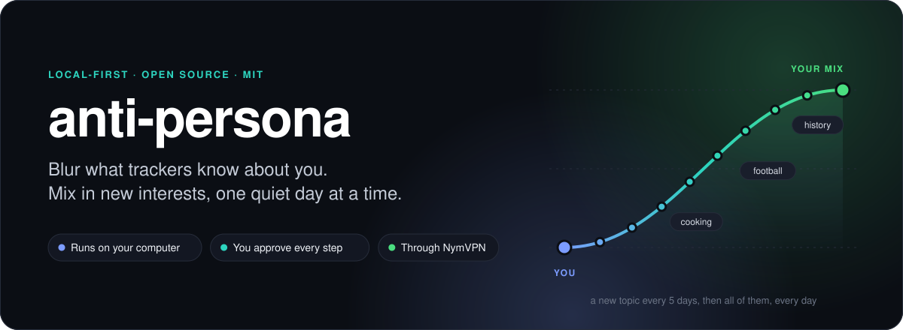
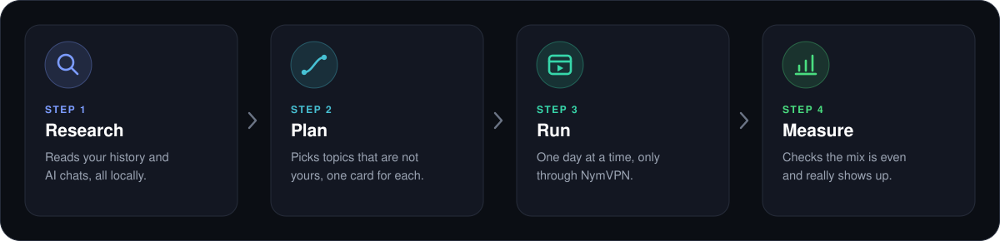
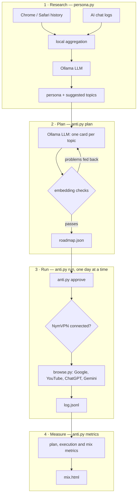

<p align="center">
  
</p>

<p align="center">
  <a href="https://github.com/emikayelyan2-glitch/web3lesson/releases"></a>
  &nbsp;
  <a href="https://github.com/emikayelyan2-glitch/web3lesson/releases"></a>
</p>

<p align="center">
  <a href="https://github.com/emikayelyan2-glitch/web3lesson/releases"></a>
  <a href="https://github.com/emikayelyan2-glitch/web3lesson/actions/workflows/ci.yml"></a>
  
  
</p>

<p align="center">
  <b>Your browser history and AI chats say who you are.</b><br>
  anti-persona reads them on your own computer, picks a mix of interests that are not yours,<br>
  and blends them into your profile in small, natural steps, through NymVPN.
</p>

<p align="center"><sub>A version of <a href="https://github.com/tonoyandev/web3lesson">tonoyandev/web3lesson</a> that mixes in interests instead of drifting to an opposite, and runs through NymVPN.</sub></p>

---

## How it works

<p align="center">
  
</p>

1. **Research.** A local AI reads a summary of your history and chats. It describes
   you, and suggests five everyday topics that have nothing to do with you, for
   example cooking, football and history. Not your opposite, just other interests.
   You can type your own topics instead.
2. **Plan.** For each topic it writes a card: the searches, videos and questions of
   a curious beginner. It checks that every card stays on its topic, far from your
   real interests, and out of sensitive areas.
3. **Run.** Once you approve, it lives one day at a time in its own Chrome window,
   always through NymVPN. It searches Google, watches YouTube, and asks the AIs you
   chose (ChatGPT, Gemini) questions, like a person with these interests would.
4. **Measure.** It checks how evenly the topics mix, and whether an outside observer
   can see them.

## One topic at a time

Real people pick up new interests slowly, so the app does too. With five topics
and the default pace:

| Days | Topics in the mix | Gets the most attention |
|---|---|---|
| 1–5 | cooking | cooking |
| 6–10 | cooking, football | football |
| 11–15 | + history | history |
| 16–20 | + travel | travel |
| 21–25 | + gardening | gardening |
| 26 and on | all five, every day | each one in turn |

A day is 7–11 actions: 5 searches, 2 videos and 2 questions to each AI you chose.
From the second day of a topic, the local AI rewords its searches and questions,
a little more experienced each time, so no day repeats another. It does not end on
its own: a profile drifts back once the noise stops, so the mix keeps going every
day until you turn it off. You can make the pace faster or slower.

**You choose which AIs see the mix.** The app finds out which ones you use: the
ChatGPT desktop app, local chats from the Gemini command line, or just the website,
from your browser history. Tick the ones you want, or none to use only Google and
YouTube.

## Why NymVPN

NymVPN hides where you are: your IP address and the metadata of your traffic.
anti-persona blurs what your accounts say about your interests. Together, the
services you use learn less about you on both levels.

- **Every run goes through NymVPN.** Before a run, the app checks NymVPN. If it is
  off, the app turns it on, and turns it off again after the run. If it cannot
  connect, nothing runs.
- **It checks again before every action.** If NymVPN drops in the middle of a day,
  the run stops right there, and the next run picks up where it stopped.
- **Your NymVPN settings stay yours.** Fast mode or the 5-hop mixnet, countries and
  the rest stay as you set them in the NymVPN app.
- **You can turn it off** in step 0 of the app, or with `anti.py vpn --require off`.
  Runs then use your normal connection.

The app talks to NymVPN through its official command-line tool, `nym-vpnc`:

| Your computer | How to get nym-vpnc |
|---|---|
| Windows | Install the NymVPN app. Then take `nym-vpnc.exe` from `nym-vpn-core-<version>_windows_x86_64.zip` of the same [NymVPN release](https://github.com/nymtech/nym-vpn-client/releases), and put it in the app's data folder (the app shows it at the top). |
| macOS | Install the NymVPN app and the `nym-vpnc` .pkg of the same release. |
| Linux | Install the `nym-vpnd` and `nym-vpnc` .deb packages of the same release. |

You can also set `NYM_VPNC` to the full path of `nym-vpnc`.

> [!IMPORTANT]
> The mix reaches your profile only through the accounts you log in to in the
> app's own Chrome window (step 4). Without a login, the noise leaves through
> NymVPN with nothing that ties it to you, so it changes nothing. Log in to the
> Google account you use every day, and to ChatGPT and Gemini if you chose them.

## Get started

**1. Install three free apps.**
[Google Chrome](https://www.google.com/chrome/), [Ollama](https://ollama.com/download)
and [NymVPN](https://nym.com/download), plus `nym-vpnc` (see above). Open Ollama
once, so it keeps running in the background.

**2. Download anti-persona** for your computer from the
[latest release](https://github.com/emikayelyan2-glitch/web3lesson/releases), then unzip it.

| Your computer | File |
|---|---|
| Mac with Apple Silicon (M1 or newer) | `anti-persona-macos-apple-silicon.zip` |
| Windows 10 or 11, 64-bit | `anti-persona-windows-x64.zip` |

**3. Open it and follow the buttons.** The first step downloads the AI models
for you. You need about 18 GB of free space for the default model.

<details>
<summary><b>First launch on a Mac</b></summary>

1. Drag `anti-persona.app` into **Applications**.
2. Open it once. macOS blocks it, because the app is not signed.
3. Go to **System Settings → Privacy & Security** and click **Open Anyway**.

Your data is kept in `~/Library/Application Support/anti-persona`.
</details>

<details>
<summary><b>First launch on Windows</b></summary>

1. Open the `anti-persona` folder and double-click `anti-persona.exe`.
2. If "Windows protected your PC" appears, click **More info**, then **Run anyway**.
3. Keep the black window open while you use the app.

Your data is kept in `%APPDATA%\anti-persona`. Put `nym-vpnc.exe` there.
</details>

<details>
<summary><b>Intel Mac, Linux, or you prefer the source code</b></summary>

You need Python 3.10 or newer, Google Chrome, Ollama and NymVPN.

```bash
git clone https://github.com/emikayelyan2-glitch/web3lesson.git anti-persona
cd anti-persona
pip3 install -r requirements.txt
```

Then start the app: double-click `Start.command` on a Mac or `Start.bat` on
Windows, or run `python3 app.py`. On Linux, `python3 app.py` works too.

The first time on a Mac, right-click `Start.command` and choose **Open**.

Prefer the terminal? Every button is a plain command:

```bash
python3 persona.py                  # 1. learn who you are, and get topics for the mix
python3 anti.py plan                # 2. make the plan (slow)
python3 anti.py approve             # 3. read and approve it
python3 anti.py login               # 4. log in once, yourself
python3 anti.py run --dry-run       # 5. see what today would do
python3 anti.py run                 #    and do it
python3 anti.py metrics --judge     # 6. check the mix
python3 anti.py schedule --at 20:00 # 7. run it every day
```

When you run from source, your data stays next to the code in `out/` and `state/`,
and `nym-vpnc` can sit next to the code too.
</details>

## Safe by design

<p align="center">
  
</p>

Please read before you start:

- **Only use it on your own computer and your own accounts.**
- **ChatGPT and Gemini do not allow bots on their websites.** Your accounts could be flagged. Choose which AIs take part in step 2 of the app, or none to use only Google and YouTube.
- **It never tries to get past a security check.** A CAPTCHA or a login page stops the run and leaves it to you. Through a VPN, Google shows these more often.
- **It stays out of sensitive topics.** Health, religion, politics, sexuality, money trouble, gambling, drugs, weapons and similar areas are never part of the mix, because a wrong profile there can hurt you. Topics you type yourself are checked too.
- **It uses its own Chrome profile.** Your everyday Chrome and its history stay untouched.

## Questions

<details>
<summary><b>How long does it take?</b></summary>

It does not end on its own. With five topics and the default pace, all of them
are in the mix from day 21, and after that the app keeps mixing them every day
until you turn it off. At most one day runs every 12 hours, and a day takes
10–15 minutes. You can change the days between topics in step 2 of the app, and
your approval and progress are kept.
</details>

<details>
<summary><b>My computer is small. Which AI model should I use?</b></summary>

Pick one in the app's first step:

| Model | Download size | Speed and quality |
|---|---|---|
| `qwen3.8` (default) | 17 GB | best plans, slowest: about 20 minutes per plan attempt |
| `qwen3:14b` | 9 GB | good balance |
| `qwen3:8b` | 5 GB | fastest, needs more retries |
</details>

<details>
<summary><b>Which AIs does it work with?</b></summary>

ChatGPT and Gemini, through their websites. Step 1 checks which ones you use and
shows why, for example:

| AI | What it looks for |
|---|---|
| ChatGPT | the desktop app, visits to chatgpt.com |
| Gemini | the desktop app if there is one, Gemini command-line chats, visits to gemini.google.com |

If it finds no app and no local chats but you visit the site, it says you use
the web version. You can tick any AI, found or not. If you change your choice
after approving a plan, approve it again; your progress is kept.
</details>

<details>
<summary><b>What exactly does it read?</b></summary>

Chrome history, Safari history on a Mac, Claude Code chats, and a ChatGPT data
export if you add one. It never changes these files. Claude Code chats are only
read, to learn about you; nothing is ever sent to Claude. The AI never sees your
raw history either, only a summary: top sites, page titles, searches, active
hours, keywords, and 30 short prompt samples. The app shows every file and its
size before it starts, and waits for your yes.
</details>

<details>
<summary><b>Does anything leave my computer?</b></summary>

The AI runs on your computer with Ollama. The only things that go online are the
searches, videos and chats of the plan itself, through NymVPN, and you approve
those first. The app listens only on your own computer, behind a secret address
that changes every time you open it.
</details>

<details>
<summary><b>How do I stop, or start over?</b></summary>

Turn off the daily run in step 7, or press **Quit**. To start over, delete your
data folder (see "First launch" above) and `~/.anti/`, which holds the app's
own Chrome profile.
</details>

---

## Under the hood

The sections below are for the curious and for contributors. You don't need
them to use the app.

<details>
<summary><b>The pipeline</b></summary>


</details>

<details>
<summary><b>Research</b></summary>

`persona.py` reads these sources and never changes them:

- Chrome history on macOS, Linux and Windows, plus extra profiles with `--chrome-history`
- Safari history on macOS
- Claude Code chats in `~/.claude/projects`
- a ChatGPT data export, with `--extra DIR`

It also checks which AI assistants you use, and saves the result in
`summary.json`: desktop apps in the usual install folders, the number of Gemini
command-line chat files, and visits to chatgpt.com and gemini.google.com in your
browser history. Only exact domains count, so look-alike sites don't. Gemini
command-line chats are counted, not read.

The model never sees your raw history. The tool first boils it down to a
summary: top domains, page titles, search terms, the hours you are active,
keywords, the share of Latin, Cyrillic and Armenian letters you type, and 30
short prompt samples. Only that summary goes to the model.

The prompt tells the model four things. Browser history describes your whole
life, while AI chats mostly describe your job. Every claim needs evidence from
the data. The topics of the mix must be unrelated to you, but not your opposite,
and different from each other. And no topic may touch a sensitive area.
</details>

<details>
<summary><b>Planning</b></summary>

The model writes all cards in one go. Each card has how a person like you would
first come across the topic, 5 searches, 2 videos and 2 questions for each chosen
AI. The searches follow your own typing style: short, lowercase, and the same
mix of languages.

The tool then checks the cards with the measurements below. If a check fails, it
tells the model exactly what went wrong, for example "card 2 drifts toward the
person's own interests". It tries up to 3 times and keeps the best plan.
</details>

<details>
<summary><b>The math</b></summary>

Every text is turned into a vector with `nomic-embed-text`. Your interests make
one centre. Each topic makes its own centre from its name and its sub-interests.

**Plan checks**

| Check | What it means | Target |
|---|---|---|
| away from you | a card's similarity to its own topic, minus its similarity to your interests | at least 0.05 for every card |
| apart from each other | a card's similarity to its own topic, minus its similarity to the closest other topic | at least 0.05 for every card |
| overlaps | sub-interests of a topic that are almost the same as one of yours (cosine 0.85 or more) | 0 |
| sensitive words | words from sensitive areas in any topic or card, in English, Russian or Armenian | 0 |

**Why the checks are relative.** Lists of search queries always look alike to an
embedding model, so a fixed threshold would let bad plans pass. Instead, each
card must be clearly closer to its own topic than to you, and than to any other
topic.

**Run checks**

| Check | What it means | Target |
|---|---|---|
| execution rate | actions that worked, out of actions tried | at least 0.9 |
| challenge rate | runs stopped by a login page or bot check | 0 |
| NymVPN stops | runs stopped because NymVPN dropped | 0 |
| still about you | share of what was really seen in the last 14 days (page titles and chat replies) that sits closest to your own interests | at most 0.2 |
| evenness | how evenly the same texts spread over the topics in the mix: 1 is perfectly even (normalised entropy) | at least 0.7 |
| judge sees | a separate model call reads only the automation profile's history and names 6 interests; the share of live topics among them | at least 0.6 |

**Why the judge reads only the automation profile.** Your main history barely
changes, and a model gives slightly different answers every time. The judge looks
only at what the tool added, so it measures just that.
</details>

<details>
<summary><b>Pacing</b></summary>

- A new topic joins every 5 days (`--days-per-topic`). On its first day it uses
  the plan's own words.
- While topics join, the newest one gets a double share of the day. Once all have
  joined, the double share goes to each topic in turn.
- Every day after a topic's first, the model rewords that day's actions in one
  call: same topics, a little more experienced, new wording. The day is saved in
  `state/days.json`, so a retry repeats it exactly.
- At most one day runs every 12 hours. A day is about 11 actions and takes
  10–15 minutes.
- Typing takes 60–180 ms per key, and reading takes 20–90 seconds per page.

A Google account that is logged in to both your normal browser and the
automation profile sees both. That is how the mix reaches your profile.
</details>

<details>
<summary><b>State and safety details</b></summary>

- **The log is the progress.** `state/log.jsonl` records every action. A run
  that stops halfway continues where it stopped, and it never repeats a
  finished action. An action that fails twice is skipped, so one broken site
  cannot block the plan.
- **Approval is tied to the plan.** The plan's id is a hash of its cards.
  Editing a card cancels the approval. So does changing which AIs the plan
  talks to, because that changes which services it touches. Changing only the
  pace keeps it. Progress is keyed by the cards alone, so a new AI choice
  never loses it.
- **Only the chosen AIs get prompts.** The plan asks the model for prompts only
  for the AIs you picked. An AI added after planning reuses the plan's ChatGPT
  prompts until you make a new plan.
- **The NymVPN guard.** `nym.py` asks `nym-vpnc status` before a run and before
  every action. A run connects NymVPN only if it was off, and then disconnects
  it again, so a tunnel you started yourself is never touched.
- **One run at a time.** A lock file, `~/.anti/run.lock`, stops two runs from
  opening the same Chrome profile, which would corrupt it. A lock left by a
  crash is cleaned up automatically. On Windows the check asks Windows whether
  the process still runs.
- **History copies are temporary.** History databases are copied to a private
  temp folder together with their journal and WAL files, read in read-only mode,
  and then deleted.
- **Untrusted text.** Page titles come from websites. They are passed to the
  model as quoted data, with an instruction to ignore any commands inside. Both
  HTML reports escape every value, and embed their data so that a `</script>`
  in a title cannot end the script, so a bad page title cannot run code.
- **Text is UTF-8 everywhere.** Armenian and Russian titles, searches and chats
  are read and written correctly on Windows too.
- **The app's local page.** It listens on `127.0.0.1` only. Every request needs
  a token that is new on each launch and a `127.0.0.1` or `localhost` Host
  header, which keeps out other websites, DNS rebinding and other users of the
  same computer. Buttons map to a fixed list of commands with checked values,
  never a shell.
- **About bot detection.** Chrome starts without the "controlled by automated
  software" banner and without the `navigator.webdriver` flag. Nothing else is
  done: no fingerprint spoofing, no CAPTCHA solving.
- **Remote model warning.** If `--host` points to another computer, the tool
  warns you, because your summary would then leave your machine.
- **Permissions.** `~/.anti` holds your logins and is set to `chmod 700`.
</details>

<details>
<summary><b>The packaged app</b></summary>

The download is `app.py` frozen with [PyInstaller](https://pyinstaller.org),
together with Python and Playwright. It drives the Chrome you installed, so no
browser is bundled, and it uses the NymVPN you installed. It is built by
`.github/workflows/release.yml` on GitHub's macOS and Windows machines every time
a release is published. The build runs all three selftests inside the finished
app before attaching it.

A few things work differently inside it:

- **No Python and no `.py` files.** The app runs its own parts through itself:
  `anti-persona --script anti selftest` is the same as `python3 anti.py selftest`.
  Every button, the daily schedule and the command line use this.
- **Data lives in a user folder.** The app's own folder is read-only (macOS) or
  replaced on update, so `out/` and `state/` go to the folder shown on the page.
  Set `ANTI_HOME` to use a different one.
- **Models download over Ollama's HTTP API**, so the `ollama` command does not
  have to be on the PATH, which a Finder-launched app does not have.
- **Daily runs need a fixed location.** macOS runs an app from Downloads from a
  random temporary path. The schedule refuses until the app is in Applications.
- **Safari history** needs Full Disk Access for the app itself: System Settings
  → Privacy & Security → Full Disk Access → add `anti-persona.app`.

Build it yourself:

```bash
pip3 install pyinstaller -r requirements.txt
```

```bash
pyinstaller --noconfirm --windowed --name anti-persona --hidden-import browse app.py
```

On Windows, use `--console` instead of `--windowed`.
</details>

<details>
<summary><b>Files it writes</b></summary>

| Path | What is inside |
|---|---|
| `out/summary.json` | the research summary |
| `out/persona.json` | you, and the suggested topics |
| `out/report.html` | research dashboard |
| `out/mix.html` | the mix dashboard |
| `state/roadmap.json` | the plan and its scores; old plans are kept as `roadmap-<id>.json` |
| `state/days.json` | the actions of each day, fixed once made |
| `state/log.jsonl` | every action and its result |
| `state/metrics.jsonl` | one line per measurement |
| `state/settings.json` | your AI choice and NymVPN settings |
| `~/.anti/profile/` | the app's own Chrome profile |

`out/` and `state/` live next to the code when you run from source, and in the
user data folder in the packaged app. They hold personal data and are
git-ignored.
</details>

<details>
<summary><b>All commands</b></summary>

**`persona.py`**

| Flag | What it does |
|---|---|
| `--yes` | skip the permission question |
| `--extra DIR` | add a ChatGPT data export |
| `--chrome-history FILE` | add another Chrome profile; can be repeated |
| `--model NAME` | Ollama model; default `qwen3.8:latest` |
| `--host URL` | Ollama address; default `http://localhost:11434` |
| `--lang LANG` | language of the report; default English |
| `--no-llm` | only statistics and charts |
| `--out DIR` | output folder; default `out/` in the data folder |
| `--selftest` | run the built-in checks |

**`anti.py`**

| Command | What it does |
|---|---|
| `plan` | make a plan; `--topics "cooking, football, history"` instead of the suggested topics, `--days-per-topic N` (default 5), `--ais chatgpt,gemini` or `none`, `--attempts N` |
| `ais` | show which AIs were found and which take part; `--set chatgpt,gemini` or `none` |
| `plan --check` | re-score a plan you edited by hand; can also change `--days-per-topic` |
| `approve` | review and approve the plan |
| `login` | open the app's Chrome profile to log in, through NymVPN |
| `run` | run the next day; `--dry-run`, `--only google,youtube,gemini`, `--days N` (demo), `--fast` (testing), `--yes`, `--force` |
| `metrics` | measure the mix; `--judge` adds the independent check |
| `vpn` | show NymVPN; `--require on/off`, `--auto-connect on/off` |
| `pull` | download `--model` through Ollama |
| `daily` | what the scheduler runs: `run --yes`, then `metrics --judge` |
| `schedule` | run daily at `--at HH:MM`; `--remove` to stop |
| `selftest` | run the built-in checks |

**`app.py`**: `--port N`, `--no-browser`, `--selftest`.

**`nym.py`** shows the NymVPN tunnel state: `python3 nym.py`.

**`browse.py`** runs one site on its own, which is the quickest way to fix a
site after a redesign:

```bash
python3 browse.py gemini "ping" --fast
```
</details>

<details>
<summary><b>Platforms</b></summary>

| | macOS | Linux | Windows |
|---|---|---|---|
| Packaged app download | ✅ Apple Silicon | – | ✅ x64 |
| App from source (`Start.command` / `Start.bat` / `python3 app.py`) | ✅ | ✅ | ✅ |
| Chrome history | ✅ | ✅ | ✅ |
| Safari history | ✅ (needs Full Disk Access) | – | – |
| Browser automation | ✅ | ✅ | ✅ |
| NymVPN guard (`nym-vpnc`) | ✅ | ✅ | ✅ |
| Daily schedule | ✅ launchd | prints a cron line | ✅ Task Scheduler |

It was first built and tested on macOS. Linux and Windows should work but are
less tested.
</details>

<details>
<summary><b>Troubleshooting</b></summary>

- **"NymVPN is required, but nym-vpnc was not found."** See "Why NymVPN" above
  for where to get it and where to put it.
- **"NymVPN did not connect."** Open the NymVPN app and check your account and
  your connection, then run again.
- **"NymVPN is not connected any more."** The tunnel dropped during a run. Run
  again once it is back; the day continues where it stopped.
- **macOS won't open the app or `Start.command`.** See "First launch on a Mac"
  above. For `Start.command`, right-click it and choose Open. If it says
  "permission denied", run `chmod +x Start.command` once.
- **Windows says "Windows protected your PC".** Click "More info", then "Run
  anyway".
- **Safari is skipped.** Give the app, or your terminal when you run from
  source, Full Disk Access in System Settings under Privacy & Security.
- **Google says "this browser may not be secure".** Use Google and YouTube
  without logging in; the history is recorded either way, but then the mix does
  not reach your Google account.
- **A chat site fails every time.** The site changed its layout. Update its
  selector in `SEL` at the top of `browse.py`, then test it with the command
  above.
- **Making the plan is slow or never passes.** Try a smaller model, fewer
  topics, or edit `state/roadmap.json` by hand and run `plan --check`.
- **"due in N h".** Only one day runs every 12 hours. `--force` skips this rule.
- **"busy: another run holds the profile".** Two runs overlapped. Wait for the
  first one to finish.
- **"this plan was made by an older version".** Plans of the old anti-persona
  path can't be reused. Make a new plan in step 2.
</details>

<details>
<summary><b>Code layout</b></summary>

```
app.py       the click-through app (and the entry point of the packaged app)
persona.py   research, summary, persona and topic prompt, report, sensitive-topic filter
anti.py      planning, math, days, state, commands, scheduling, mix dashboard
nym.py       the NymVPN guard, through nym-vpnc
browse.py    the browser; the only file that needs playwright
docs/        the images in this README
ROADMAP.md   what comes next
```

It uses only the Python standard library, plus Playwright for the browser.
</details>

## Contributing

Issues and pull requests are welcome. Please run the checks first:

```bash
python3 persona.py --selftest
```

```bash
python3 anti.py selftest
```

```bash
python3 app.py --selftest
```

CI runs them on Python 3.10 and 3.13. Keep the dependency list short, and
never commit anything from `out/` or `state/`.

Where the project is going, and what it needs to become a real product, is in
the [roadmap](ROADMAP.md).

## License

[MIT](LICENSE)
